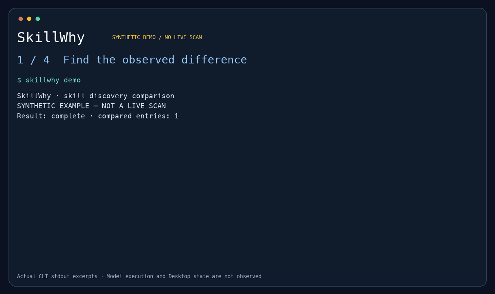

# SkillWhy

**Same repo. Different skills. Find the difference.**

SkillWhy compares the skills that fresh Codex CLI processes discover. Capture two local environments, inspect their differences, and prepare a small support bundle without sharing your full configuration.

**Early alpha.** Native discovery is limited to explicitly supported CLI and OS versions. A discovered or enabled skill is **not proof that a model read or executed it**. An existing Desktop session is not inspected.



Actual CLI output from synthetic fixtures, shown as excerpts. [Video](https://github.com/hyscodebase/skillwhy/blob/main/assets/demo.mp4) · [Full transcript](https://github.com/hyscodebase/skillwhy/blob/main/assets/demo-transcript.txt). This demonstrates the workflow; external user outcomes are still being evaluated.

## Try the offline demo

Requires Node.js 22 or later:

```sh
npx --yes @hyscodebase/skillwhy@alpha demo
```

The first run downloads the compiled [npm package](https://www.npmjs.com/package/@hyscodebase/skillwhy). The demo uses synthetic snapshots. It needs no Codex installation, API key, or model call.

To install once and use the shorter `skillwhy` command:

```sh
npm install --global @hyscodebase/skillwhy@alpha
skillwhy demo
```

Use the explicit `alpha` tag while prereleases are being evaluated. [GitHub release tarballs](https://github.com/hyscodebase/skillwhy/releases) with SHA-256 checksums remain available. From a checkout, use `npm ci`, then `npm run demo`; replace `skillwhy` below with `node dist/src/cli.js`.

```text
SkillWhy · skill discovery comparison
SYNTHETIC EXAMPLE — NOT A LIVE SCAN

key:demo:release-review · enabled-changed
  true → false [observed]

Model selected/read/executed a skill: NOT OBSERVED
Existing Desktop session: NOT ASSESSED
```

## Capture and compare

```sh
skillwhy capture --cwd ./my-project --out before.snapshot.json --digest
# After changing a skill or its configuration, capture the same project again:
skillwhy capture --cwd ./my-project --out after.snapshot.json --digest
skillwhy diff before.snapshot.json after.snapshot.json \
  --map-root project=project --detail
```

Capture asks a new local Codex process for metadata only. It sends no model turns or configuration writes. The native process can still have its own startup, cache, logging, and network behavior. Read the [compatibility notes](docs/compatibility.md).

`--map-root project=project` explicitly confirms which roots correspond and limits comparison to those roots. Unselected global entries are counted as unassessed. SkillWhy preserves same-name copies, reports ambiguous matches, and keeps missing evidence unknown. It does not choose a winner or infer model routing.

Optional `--digest` fingerprints only `SKILL.md` files within the selected project. Matching fingerprints do not establish equality of scripts, dependencies, or behavior.

## Share one selected skill

Inspect the snapshot to find the entry to share. Replace `release-review` with your skill's name. Duplicate names appear with separate IDs:

```sh
skillwhy inspect after.snapshot.json --skill release-review
skillwhy share --snapshot after.snapshot.json \
  --skill release-review --alias review --preview
skillwhy share --snapshot after.snapshot.json \
  --skill release-review --alias review --out local.share.json
skillwhy diff maintainer.share.json local.share.json --detail
```

Use the same explicit alias only for entries you have confirmed correspond. If names are duplicated, replace `--skill release-review` with `--entry ENTRY_ID` from `inspect`. This alpha exports one entry per bundle. `inspect` is a local view: it includes skill names and relative locations, so use `share --preview` for the file you intend to send.

By default, bundles exclude skill names, bodies, descriptions, source paths, fingerprints, logs, and unselected entries. `--include-name` and `--include-digest` are explicit opt-ins. Preview the file before sharing it yourself; the tool never uploads it. See [data handling](docs/privacy.md).

## What the result means

| Result | Meaning |
| --- | --- |
| `enabled-changed` | The two observations report different enabled values |
| `content-changed` | Collected SKILL.md fingerprints differ |
| `unknown` | A required observation or shared field is missing |
| `ambiguous-match` | Multiple entries could correspond; none was guessed |
| `inconclusive` | The comparison could not establish a complete result |

Exit `0` means the command completed; differences are normal. Exit `2` means input, collection, compatibility, or comparison was inconclusive. This alpha is not an automatic CI policy gate.

## Why another tool?

[skillscope](https://github.com/heidihowilson/skillscope) provides multi-host inspection. [coding-agent-skills](https://github.com/EJRyan89/coding-agent-skills/blob/main/docs/codex-support.md) already verifies native discovery and catalog exposure. SkillWhy focuses on a small, inspectable comparison and support-file workflow. It does not claim a new discovery algorithm.

## Development

```sh
npm ci
npm test
npm run typecheck
```

No runtime dependencies. Tests use synthetic records and local fake subprocesses; [live compatibility observations](docs/validation.md) are documented separately. Tag releases run the test matrix, install the packaged CLI in a temporary directory, and publish the tarball with its checksum; see [release maintenance](docs/releasing.md).

Try the [10-minute pilot](docs/pilot.md) to report installation friction or a useful support case. External pilot outcomes have not yet been established.

For incomplete results, see [troubleshooting](docs/troubleshooting.md). Maintainers can use the [interview guide](docs/interviews.md) and [weekly metrics](docs/metrics.md) to track feedback. [npm distribution](docs/npm-publishing.md) records publication and clean-install evidence.

[Contributing](CONTRIBUTING.md) · [Security](SECURITY.md) · [한국어](docs/README.ko.md) · [Roadmap](docs/roadmap.md)

MIT licensed. No default telemetry, accounts, or hosted service.
