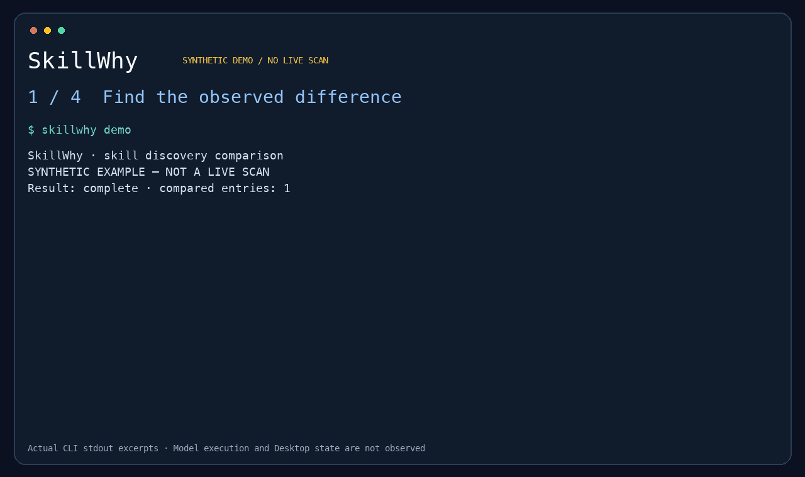

# SkillWhy

같은 저장소를 설치했는데 서로 다른 Skill이 보이는 상황을 조사하는 CLI입니다.
Codex CLI를 새로 실행해 발견 목록을 수집하고 두 환경을 비교합니다.



실제 CLI 출력의 일부를 사용한 합성 예시입니다. [영상](https://github.com/hyscodebase/skillwhy/blob/main/assets/demo.mp4)과 [전체 출력 기록](https://github.com/hyscodebase/skillwhy/blob/main/assets/demo-transcript.txt)도 제공합니다.

Node.js 22 이상이 있다면 한 줄로 데모를 실행할 수 있습니다.

```sh
npx --yes @hyscodebase/skillwhy@alpha demo
```

처음에는 빌드된 [npm 패키지](https://www.npmjs.com/package/@hyscodebase/skillwhy)를 다운로드합니다.
빌드된 패키지를 한 번 설치하고 짧은 명령으로 사용하려면:

```sh
npm install --global @hyscodebase/skillwhy@alpha
skillwhy demo
```

초기 버전을 사용하려면 `alpha` 태그를 명시하세요. SHA-256 체크섬이 포함된
[GitHub 릴리스 파일](https://github.com/hyscodebase/skillwhy/releases)도 제공합니다.
데모는 합성 데이터이며 API 키와 Codex 설치가 필요하지 않습니다.
실제 수집은 검증된 Codex/OS 조합만 지원합니다.

핵심 명령은 `demo`, `capture`, `inspect`, `diff`, `share`입니다.
사용법은 [영문 README](../README.md), 지원 범위는
[호환성 문서](compatibility.md)를 참고하세요.

```sh
skillwhy capture --cwd ./my-project --out before.snapshot.json --digest
# Skill 또는 설정을 바꾼 뒤 같은 프로젝트를 다시 수집합니다.
skillwhy capture --cwd ./my-project --out after.snapshot.json --digest
skillwhy diff before.snapshot.json after.snapshot.json --map-root project=project --detail
skillwhy inspect after.snapshot.json --skill release-review
skillwhy share --snapshot after.snapshot.json --skill release-review --alias review --preview
```

`release-review`는 조사할 Skill의 이름으로 바꿉니다. 같은 이름이 여러 개면
`inspect`에서 ID를 확인하고 `share --entry ID`로 한 항목을 선택합니다.
`inspect`는 로컬 확인용이며 이름과 상대 경로를 보여줍니다. 전달할 내용은
`share --preview`로 확인한 뒤 `--preview`를 `--out local.share.json`으로 바꿔 저장하세요.
비교할 두 공유 파일의 `--alias`는 실제로 같은 항목이라고 확인했을 때만 같게 지정합니다.

`--map-root project=project`는 두 프로젝트 경로가 대응함을 명시합니다.
프로젝트 밖의 항목은 이 비교에서 평가하지 않습니다. `--digest`는 프로젝트 안의
`SKILL.md`만 읽으며 참조 스크립트 전체의 동일성을 확인하지 않습니다.

발견됨·활성화됨은 모델이 실행했다는 뜻이 아닙니다. 현재 열려 있는
Desktop 채팅의 상태도 검사하지 않습니다. 공유 파일은 한 항목을 선택하고
공개 내용을 확인한 뒤 사용자가 직접 전달합니다. 자동 업로드는 없습니다.

혼자 유지할 수 있도록 서버·로그인·DB·다중 호스트를 초기 범위에서 제외했습니다.
1,000스타는 도전 목표이며 제품의 성능이나 성공을 보장하는 수치가 아닙니다.

실제 실행 검증은 [검증 기록](validation.md), 다음 버전 발행과 지원 범위 확대 절차는
[릴리스 가이드](releasing.md)를 참고하세요. npm 공개 레지스트리와 GitHub에서 패키지를 배포합니다.

첫 사용 경험과 실제 도움 여부를 확인할 [10분 파일럿 안내](pilot.md)와 피드백 양식도 제공합니다.
외부 사용자의 파일럿 결과와 반복 사용은 아직 검증되지 않았습니다.

결과가 불완전할 때는 [문제 해결 안내](troubleshooting.md)를 확인하세요.
유지관리자용 [인터뷰 질문과 판정 기준](interviews.md), [후보 조사와 초대 초안](outreach.md),
[주간 지표](metrics.md)도 준비했습니다. npm 레지스트리 게시 상태와 준비 절차는
[npm 배포 문서](npm-publishing.md)에 기록합니다.
